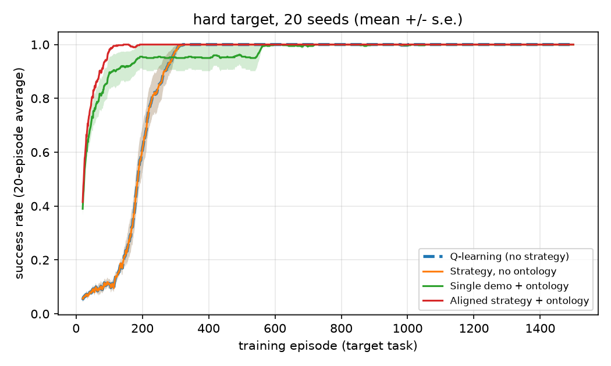
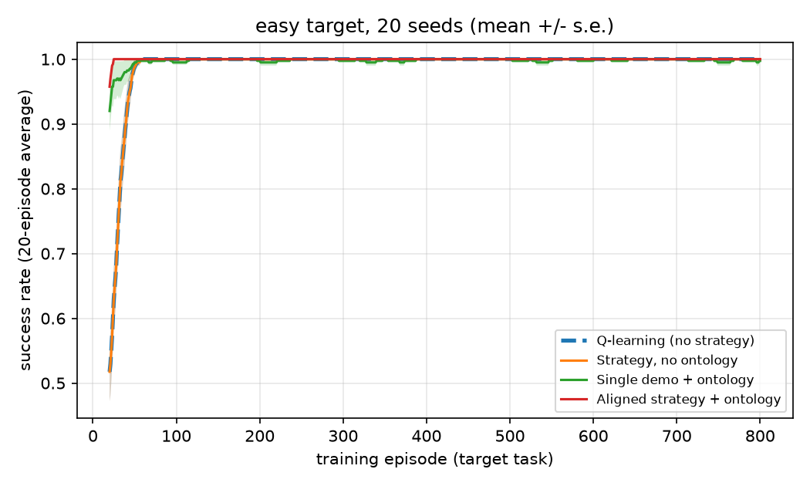

# Strategy Transfer Between Gridworlds with Different Vocabularies

Can a strategy extracted from demonstrations in one task speed up reinforcement
learning in a task with a different layout and different object names?

## Method

1. Train a Q-learning agent in a source gridworld (key, door, goal, coin).
2. Record noisy demonstrations as event sequences, e.g.
   `acquire key -> unlock door -> reach goal`. Some demos also pick up the coin.
3. Extract the common strategy with Needleman-Wunsch sequence alignment across
   30 demos, keeping steps that appear in at least 60% of them.
4. Generalise the strategy with a small hand-written ontology
   (key and lever are both a "tool", door and gate a "barrier", goal and exit an "objective").
5. In the target gridworlds (lever, gate, exit, gem), use the strategy for
   potential-based reward shaping and compare against baselines over 20 seeds.

Extracted strategy: `[('acquire', 'key'), ('unlock', 'door'), ('reach', 'goal')]`

After the ontology: `[('acquire', 'tool'), ('unlock', 'barrier'), ('reach', 'objective')]`

## Conditions compared

| Condition | What it tests |
|---|---|
| Q-learning (no strategy) | Baseline |
| Strategy, no ontology | Source-vocabulary strategy in a target with different names (sanity check) |
| Single demo + ontology | Strategy copied from one demonstration, no alignment |
| Aligned strategy + ontology | Full pipeline |

## Results

20 seeds per condition, mean ± standard error. Success rate is a 20-episode moving average.

| Target | Condition | Episodes to 90% success |
|---|---|---|
| Hard | Q-learning (no strategy) | 215.8 ± 9.7 |
| Hard | Strategy, no ontology | 215.8 ± 9.7 |
| Hard | Single demo + ontology | 92.5 ± 24.8 |
| Hard | Aligned strategy + ontology | 62.1 ± 1.3 |
| Easy | Q-learning (no strategy) | 34.4 ± 1.8 |
| Easy | Strategy, no ontology | 34.4 ± 1.8 |
| Easy | Single demo + ontology | 21.5 ± 1.5 |
| Easy | Aligned strategy + ontology | 20.0 ± 0.0 (metric floor) |

Raw output is in [`results/output.txt`](results/output.txt).

### Hard target



*Success rate over training episodes on the larger map, 20 seeds. Shaded bands show standard error. The dashed line is plain Q-learning; "Strategy, no ontology" overlaps it exactly.*

### Easy target



*Same comparison on the smaller map. The aligned strategy sits at the metric floor (20 episodes, the window size), so this map is mainly a sanity check.*

### Summary

An aligned, ontology-lifted strategy reached 90% success about 3.5x faster than
plain Q-learning on the hard target. Without the ontology, strategy events never
match target events and the result equals the baseline. A strategy copied from a
single demonstration was slower and much more variable, consistent with spurious
steps such as collecting the distractor being carried over from individual demos.
All conditions reach the same final success rate, as expected from potential-based
shaping, which speeds up learning without changing the optimal policy.

## Limitations

- The tasks are small and tabular, and the ontology is hand-written, not learned.
- The demos contain only two distinct event sequences, so alignment here is close
  to majority voting. Richer, more varied demos would be a harder test.
- Only one linear strategy is extracted, with no conditional or hierarchical structure.
- There is no exploration-bonus baseline, so part of the speed-up may come from
  denser reward rather than strategy knowledge specifically.
- The hard map places the distractor behind the gate, which deliberately penalises
  strategies that include a distractor step.

## Next steps

- Learn the object-to-concept mapping instead of writing it by hand.
- Extract conditional or hierarchical strategies from richer demonstrations.
- Add an exploration-bonus baseline and test on larger, less structured domains.

## Run

```
pip install -r requirements.txt
python run_experiment.py > results/output.txt
```

The full run takes several minutes. Set `N_SEEDS` at the top of
`run_experiment.py` to a small number for a quick test.

## Structure

```
src/env.py          gridworlds, event system, ontology
src/agent.py        Q-learning, reward shaping, demo recording
src/strategy.py     sequence alignment, strategy extraction
run_experiment.py   full experiment and plots
results/            output table and learning-curve plots
```